# Agentic ID

> **Branch `v3/plugin-on-v3`.** On this branch the plugin runs on the Agentic ID V3 API through
> its own bundled server. Start with [docs/v3.md](docs/v3.md) and
> [plugins/agentic-id/README.md](plugins/agentic-id/README.md). The rest of this page still
> describes the hosted v2 endpoint (five tools, OAuth sign-in) and is rewritten before release.

**One open ID for every person, company and agent.**

Agentic ID is an open identity protocol and a shared ledger. Resolve any person or company to one stable ID, with the evidence behind the match. Anyone can look up an ID, and anyone can add verified links back.

Live today for US work identity and companies worldwide: 75M+ people and companies resolved and verified, used by 500+ teams. More regions and consumer identity come next, consent-gated.

Open spec, open code, community ledger. Started at [iCustomer](https://icustomer.ai).

[](LICENSE)  

**[Get free credits](<SIGNUP_URL>)** · [Quickstart](#quickstart) · [Why Agentic ID](#why-agentic-id) · [The spec](#the-spec) · [Integrations](#choose-your-integration) · [The five tools](#the-five-tools) · [Credits](#credits-and-guardrails) · [Other agents](docs/agents.md)

---

<p align="center">
  
</p>

An agent asks who `maya.chen@tallpinesoftware.com` is. Agentic ID matches the hashed work email against the ledger and returns Maya Chen, VP Marketing at Tallpine Software, with a stable ID, confidence 0.97, no conflict, 0 credits. The issued ID is recorded in the ledger.

## How this started

Agentic ID started inside iCustomer. We were building Growth Brain for growth teams, and every decision broke at the same step: one person showed up as five records across a CRM, a warehouse and three ad platforms. So we built an ID system for ourselves.

It has since resolved and verified 75M+ people and companies for 500+ teams. Identity shouldn't belong to one vendor, so we're opening the spec, the code and the ledger.

## The ledger

Agentic ID is an open ledger protocol. iCustomer runs the first node. The reference node is open source so anyone can run one.

| You can | How | Cost |
|---|---|---|
| **Look up** | Resolve any identifier against the shared ledger | Free for contributing workspaces |
| **Contribute** | Add hashed keys and the evidence behind a link. Links enter the ledger only with evidence. Every contributor has a reputation score. | Free, and it makes resolution better for everyone |
| **Own** | Your records stay yours. The ledger stores hashed links, never raw data. | Free |

Ownership is layered. The person or company owns its ID and consent. Each brand owns its own relationship records. The ledger only connects them.

## Why Agentic ID

Most data tools look things up. An email goes in and a guess comes out. Agentic ID resolves: every person and company maps to one stable identity, and every link to that identity needs evidence.

**One ID per entity.** Start from an email, a LinkedIn URL, or a name plus company. You get the same ID whichever one you use.

**Evidence, not guesses.**
- Every match says what it matched on and how confident it is.
- Weak input comes back as `needs_evidence`, with what to add.
- Identifiers that point at two records come back as a conflict. They're flagged, never merged.
- Every issued ID is recorded: which ID went to which workspace, for which request.

**A data co-operative.**
- Workspaces that contribute make resolution better for everyone in the network.
- A workspace can opt out and keep its keys private.
- A workspace's own facts and outcomes never leave it.
- Matching runs on hashed keys.

**Made for agents.** Hard credit caps on every call. Errors that tell the agent what to fix. Skills that teach the agent when to resolve, enrich, find or discover. Deliverability checks (`validate`) are one step in that flow.

<p align="center">
  
</p>

## The spec

`spec/` defines the Agentic ID: the identity schema, the match-key format, the DID method (`did:agenticid:`) and the ledger protocol. It's licensed CC BY 4.0. Anyone can implement it, and issues and PRs on the spec are welcome.

Entity types: `person` and `company` today, with `household` and `agent` reserved. Identifier classes: work identifiers today (work email, LinkedIn URL, company domain), consumer identifiers next (personal email, phone, device), consent-gated.

| Part | Path | License |
|---|---|---|
| Spec | `spec/` | CC BY 4.0 |
| Claude Code plugin, skills, evals | `plugin/` | MIT |
| CLI | `cli/` | MIT |
| TypeScript SDK | `sdk/` | MIT |
| Reference ledger node | `node/` (coming) | AGPL-3.0 |

## Quickstart

In Claude Code:

```bash
claude plugin marketplace add icustomerai/agentic-id
claude plugin install agentic-id@icustomer
```

Restart Claude Code, run `/mcp`, choose `plugin:agentic-id:agentic-id` → **Authenticate**, and sign in with your iCustomer account. New accounts get free credits. Then ask:

> Who is maya.chen@tallpinesoftware.com? Then find two more marketing leaders at her company. 6 credits max.

```
✓ Maya Chen · VP Marketing · Tallpine Software
  id did:agenticid:person:7a1e0c9f3bqk2m8xn4vd6hwt0r · matched on work_email · confidence 0.97 · free

Marketing leaders at tallpinesoftware.com (2 of 7 found):
  Daniel Okoro   Head of Demand Generation     email unverified
  Sofia Marin    Director, Product Marketing   email unverified

Charged 4 credits (cap 6). 46 credits left.
```

Using Codex, Cursor, Hermes, Pi or another agent? See [docs/agents.md](docs/agents.md).

## Choose your integration

Every surface calls the same API, with the same inputs, outputs, error codes and credits.

| Surface | Use it when | Get it | Status |
|---|---|---|---|
| Claude Code plugin | You work in Claude Code | `claude plugin install agentic-id@icustomer` | ✅ Stable |
| MCP server | Your agent speaks MCP | `<PROD_MCP_URL>` | ✅ Live |
| Agent Skills | Your agent reads SKILL.md | Link `plugin/skills/*` ([how](docs/agents.md)) | ✅ Stable |
| CLI | CSV files, scripts, CI, agents without MCP | `npm i -g @agentic-id/cli` | 🧪 Preview |
| TypeScript SDK | You're building an app or service | `npm i @agentic-id/sdk` | 🧪 Preview |
| REST API | Any other language | `POST /v1/entities/<verb>` | ✅ Live |

Use the MCP server where your agent supports it (it handles sign-in) and the CLI where it doesn't. The skills cover both.

## The five tools

Resolve is the core. Enrich, find and discover build on resolved identities. Validate checks deliverability before you send.

| Verb | Ask it | MCP tool | CLI | Credits* |
|---|---|---|---|---|
| **resolve** | Who is this? Email, LinkedIn URL, or name plus company to one stable ID, with what it matched on and how confident it is. | `agentic_id_resolve` | `agentic-id resolve` | Free |
| **enrich** | Title, work email, LinkedIn. Or a company's industry, size and HQ. Up to 100 per call. Each person comes back as *Enriched with email* (safe to send), *Enriched*, or *Not Enriched*. | `agentic_id_enrich` | `agentic-id enrich` | 1 per source that contributed: about 2 per person, 1 to 3 per company |
| **find** | Who holds role X at company Y? Decision makers by default. | `agentic_id_find` | `agentic-id find` | 1 per person returned |
| **discover** | Which companies and people match my ICP? Industry, country, size, revenue, keywords and tech stack are hard filters. | `agentic_id_discover` | `agentic-id discover` | 1 per account plus 1 per contact |
| **validate** | Is this mailbox deliverable? Up to 1,000 per call. | `agentic_id_validate` | `agentic-id validate` | 1 per valid, catch-all or risky. Invalid, unknown and domain-only checks are free |

\* Measured on the production service on <DATE>. The `cost` block in every answer is authoritative.

Exact arguments for every tool: [plugin/skills/agentic-id/references/tools.md](plugin/skills/agentic-id/references/tools.md).

## Claude Code plugin

`plugin/` bundles the MCP server entry, the skills and a few Claude Code extras.

| Component | What it does |
|---|---|
| Skill `agentic-id` | Picks the right verb, shows exact arguments, applies the credit and B2B-only rules. Falls back to the CLI when the MCP tools are missing. |
| Skill `who-matters` | Playbook: validate, resolve, enrich, find and discover inside a budget agreed up front. |
| Skill `agentic-id-credits` | Prices, estimating and capping spend, quoted vs charged credits. |
| Agent `lead-qualification` | Works a lead list end to end inside a credit budget and returns a clean list grouped by account. |
| Hook (PostToolUse) | Writes one line per call to `~/.agentic-id/usage.jsonl`: tool, outcome, request id, credits. Never inputs or results. |
| Command `/agentic-id-usage` | Credits per tool and the last 20 calls from that log. |

For CI and headless runs the plugin can send an API key instead of using OAuth. See [API-key mode](docs/agents.md#api-key-mode). `agentic-id login --with-api-key` writes the same key file, so one step sets up both.

**Troubleshooting**
- *Shows "Needs authentication" after you added an API key.* Claude Code remembers that a server needed sign-in and skips it for a while. Run `/mcp`, pick `agentic-id`, choose **Reconnect**. Headless runs (`claude -p`) can't do this, so start the first run in a trusted folder with the key already in `~/.agentic-id/api-key`.
- *Skill changes don't show up after `claude plugin update`.* Updates are keyed on the version in `plugin.json`. Every release bumps it.

## MCP server

| Setting | Value |
|---|---|
| Transport | Streamable HTTP |
| URL | `<PROD_MCP_URL>` |
| Auth | OAuth 2.1 with PKCE (your agent opens a browser), or `x-api-key` |
| Tools | `agentic_id_validate`, `agentic_id_resolve`, `agentic_id_enrich`, `agentic_id_find`, `agentic_id_discover` |

```json
{ "mcpServers": { "agentic-id": { "type": "http", "url": "<PROD_MCP_URL>" } } }
```

## CLI (preview)

```bash
npm i -g @agentic-id/cli
agentic-id login      # browser sign-in with your iCustomer account
agentic-id doctor     # checks server, sign-in, credits and file permissions
```

Point it at a CSV, give it a budget, get rows back:

```bash
agentic-id resolve  --email maya.chen@tallpinesoftware.com --max-credits 1
agentic-id validate --file leads.csv --max-credits 500 -o csv > verdicts.csv
agentic-id enrich   --file leads.csv --required-fields email,job_title --max-credits 300 -o csv > enriched.csv
agentic-id find     --domain tallpinesoftware.com --roles "VP Marketing" --limit 5 --max-credits 10 -o jsonl
agentic-id credits  # balance, holds, recent movements (free)
```

- **Budgets hold for the whole file.** With `--file`, `--max-credits` caps the entire run. Rows not sent come back as `skipped`.
- **Dirty rows don't stop a run.** A refused row (personal email, placeholder name) comes back `rejected` at no cost. If the service fails part-way, everything already paid for is printed, the rest is marked `not_sent`, and the exit code is 1.
- **Machine output.** `-o csv`, `-o jsonl` or `--json`. CSV cells that would run as spreadsheet formulas are neutralised.
- **Safe retries.** `--idempotency-key` returns the first answer instead of charging again.
- **Exit codes.** 0 ok, 1 API error, 2 bad input (nothing sent), 3 config, sign-in or connection problem.

## TypeScript SDK (preview)

No dependencies, uses global `fetch`. Runs on Node 18+, Deno, Bun and in browsers.

```ts
import { AgenticId, AgenticIdError } from '@agentic-id/sdk';

const aid = new AgenticId({ apiKey: process.env.AGENTIC_ID_API_KEY! });

const check = await aid.validate({ identifiers: { email: 'maya.chen@tallpinesoftware.com' }, max_credits: 1 });
console.log(check.email_validation?.status, check.cost); // "valid" { quoted_credits: 1, charged_credits: 1 }

try {
  await aid.enrich({ contact: { email: 'maya.chen@tallpinesoftware.com' }, required_fields: ['job_title'], max_credits: 2 });
} catch (e) {
  if (e instanceof AgenticIdError) console.error(e.code, e.fix); // e.g. insufficient_credits
}
```

Methods: `validate`, `resolve`, `enrich`, `find`, `discover`, `credits`.

## REST API

```bash
curl -s <PROD_API_URL>/v1/entities/validate \
  -H "x-api-key: $AGENTIC_ID_API_KEY" -H "content-type: application/json" \
  -H "Idempotency-Key: $(uuidgen)" \
  -d '{"identifiers":{"email":"maya.chen@tallpinesoftware.com"},"max_credits":1}'
```

| Verb | Route |
|---|---|
| validate | `POST /v1/entities/validate` |
| resolve | `POST /v1/entities/resolve` |
| enrich | `POST /v1/entities/enrich` |
| find | `POST /v1/entities/find` |
| discover | `POST /v1/entities/discover` |
| credit balance | `GET /v1/credits` |

Reusing an `Idempotency-Key` with a different body returns `409 idempotency_key_reused`.

## Authentication

Every surface accepts a signed-in iCustomer account or an API key. Both act as the same workspace.

| You are | Use | How |
|---|---|---|
| A person in Claude Code or another agent | OAuth | `/mcp` → `agentic-id` → Authenticate |
| A person at a terminal | OAuth | `agentic-id login`. Renews itself for 30 days of use. |
| A script, CI job or headless agent | API key | `AGENTIC_ID_API_KEY`, or `agentic-id login --with-api-key < key.txt` (saves to `~/.agentic-id/api-key`, mode 0600) |

`agentic-id whoami` shows which credential is in use and never prints it. Never put an API key in a URL, prompt, chat message or committed file. The skills tell agents never to ask for one in chat.

## Credits and guardrails

You pay only for results delivered. Rejected input, misses and errors on our side are free.

- `max_credits` is a hard budget. Required on validate, resolve, enrich and find. It also caps rows on discover. A call that can't fit returns `credit_cap_reached` and spends nothing.
- `limit` caps rows on find (default 20, max 100) and discover (default 100). The skills always set it.
- Every answer shows `cost.quoted_credits` (the most it could cost), `cost.charged_credits` (what it did cost) and `ledger.available_after`.
- The skills make the agent report credits after each call, total them for multi-step work, and ask before raising a budget.

## Errors

JSON with a machine-readable `code` and a `fix` the agent can act on:

```json
{ "error": "credit_cap_reached", "message": "max_credits 1 cannot pay for any contact...", "fix": "Raise max_credits or request fewer rows or fields." }
```

| Code | HTTP | Meaning |
|---|---|---|
| `invalid_input` | 400 | Missing or malformed field, or test data such as `test@` or `example.com` |
| `identifier_class_not_enabled` | 422 | A consumer identifier (personal email, phone, device ID). Work identifiers only for now. |
| `region_not_enabled` | 422 | A person outside the US. Company lookups still work. |
| `credit_cap_reached` | 402 | `max_credits` can't cover the cheapest paid step |
| `insufficient_credits` | 402 | Workspace balance can't cover the call |
| `no_match` / `not_found` | 404 | Nothing found, nothing charged |
| `rate_limited` | 429 | Retry after `Retry-After` |
| `provider_unavailable` | 503 | An upstream source failed, nothing charged |

Full list: [references/errors.md](plugin/skills/agentic-id/references/errors.md).

## Where your data goes

- **Work identifiers only for now.** Work emails, LinkedIn profile URLs, names with a company, company domains. Personal emails, phone numbers and device IDs are refused until consumer identity ships with consent controls.
- **People in the US, companies everywhere.** Person lookups outside the US return `region_not_enabled`. Company lookups work in every region. See [spec/contributions.md](spec/contributions.md#jurisdiction).
- **Bad input stops before it costs anything.** Test addresses, placeholder names and disposable domains are refused before any lookup.
- **Requests go only to the server you configured.** Results come back into your agent's conversation. Handle them under your organisation's data policy.
- **The local usage log holds no personal data.** Timestamp, session, tool, outcome, error code, request id and credits. Mode 0600, delete it any time.

## Skills and evals

The skills are plain Agent Skills and work in any agent that reads SKILL.md. Every skill change is tested with `claude plugin eval` against synthetic mocks (`plugin/evals/mocks/`), so evals need no API key, no credits and no real data.

| Group | Checks |
|---|---|
| `triggering/` | The right skill loads for natural requests, and none loads for unrelated work |
| `behaviour/` | Batches emails into one validate call, always passes `limit` and `max_credits`, reports cost and unverified emails, flags results that don't match the roles asked for, never sends personal data, stops on `insufficient_credits` without retrying, validates before enriching, shrinks a plan to fit the budget, hands lead lists to the `lead-qualification` agent |

```bash
./test/evals.sh                    # full suite: 3 runs per case, with and without the plugin
EVAL_QUICK=1 ./test/evals.sh       # 1 run per case, no baseline
./test/evals.sh --tag triggering   # one group
```

`test/evals.sh` always passes `--no-publish` and a cost ceiling (`EVAL_MAX_COST_USD`, default $10).

## Development

```bash
./test/validate.sh   # manifests, JSON, frontmatter, eval structure, secrets scan, unit tests (no network)
./test/evals.sh      # skill evals against mocks (model cost only)

# Against a live server (spends about 1 to 3 credits):
AGENTIC_ID_MCP_URL=<url> AGENTIC_ID_API_KEY=... node test/protocol.test.mjs
AGENTIC_ID_MCP_URL=<url> AGENTIC_ID_API_KEY=... E2E_MODE=helper ./test/e2e.sh
```

```
.claude-plugin/marketplace.json     Claude Code marketplace "icustomer"
spec/                               Agentic ID spec (CC BY 4.0)
plugin/
  .claude-plugin/plugin.json        plugin manifest
  .mcp.json                         MCP server entry: OAuth, optional API-key headersHelper
  skills/                           portable Agent Skills
  agents/lead-qualification.md      subagent
  commands/agentic-id-usage.md      slash command
  hooks/                            PII-free usage log
  scripts/                          headersHelper, usage summary
  evals/                            skill evals and tool mocks
cli/                                CLI (MIT)
sdk/                                TypeScript SDK (MIT)
docs/agents.md                      setup for Codex, Hermes, Pi and other agents
docs/release-notes/
test/                               validate.sh, evals.sh, e2e.sh, protocol test, fixtures
```

## Editions

| Edition | What you get | Price |
|---|---|---|
| **Agentic ID** (open source) | Spec, SDK, CLI, plugin, reference node. Run it yourself. | Free |
| **Agentic ID Cloud** (hosted by iCustomer) | The shared ledger, resolution across 100+ independent sources, credits | Pay per use. Free credits to start. |
| **iCustomer Enterprise** | Agentic ID inside your own warehouse, ongoing monitoring, SLA and DPA, plus Growth Brain | Annual packs. [Talk to us](https://icustomer.ai). |

## Contributing, security, license

- Contributions: [CONTRIBUTING.md](CONTRIBUTING.md). We use the DCO (`git commit -s`).
- Security issues: [SECURITY.md](SECURITY.md). Please don't open a public issue.
- Questions: open an issue, or reach Abhi Yadav at [<EMAIL>].
- Changes: [CHANGELOG.md](CHANGELOG.md).
- Licenses: MIT for `plugin/`, `cli/` and `sdk/` (copyright iCustomer), CC BY 4.0 for `spec/`, AGPL-3.0 for `node/`. Need a different license for the node? Talk to us. See [LICENSE](LICENSE).
